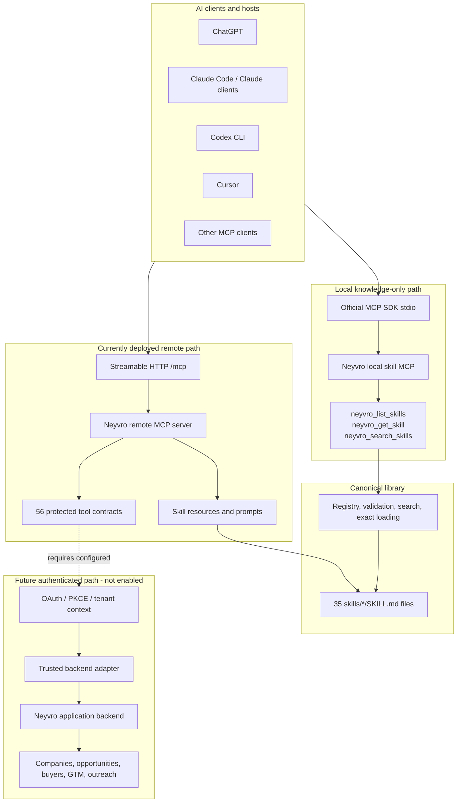

# Neyvro MCP

**Connect AI agents to Neyvro’s company intelligence and go-to-market workflows through the Model Context Protocol.**

Neyvro helps GTM teams reason about which companies deserve attention, what
changed, what problems might emerge, who is responsible, and what action should
be considered next. Neyvro MCP packages that reasoning as portable Agent Skills
and MCP surfaces for Codex, Claude Code, Cursor, ChatGPT, and compatible clients.

This repository is the MCP and skills project. The main Neyvro application is a
separate repository: [neyvro-Distributor/neyvro](https://github.com/neyvro-Distributor/neyvro).
The two repositories must not be described as a live integration unless an
authenticated backend test proves it.

## Current status

The deployed public transport and knowledge library are working. Private
customer-data access is intentionally fail-closed until production OAuth and a
trusted backend identity exchange are configured.

| Area | Status | Current evidence |
|---|---|---|
| Local knowledge MCP | VERIFIED | Official Python MCP SDK, stdio transport, repository tests |
| Remote Streamable HTTP MCP | VERIFIED | `https://opengtmn-neyvro.onrender.com/mcp` |
| Health endpoint | VERIFIED | `https://opengtmn-neyvro.onrender.com/health` returns HTTP 200 |
| Public skill catalog | VERIFIED | 35 skills, resources, and prompts |
| Mandatory skills | VERIFIED | 26 required skills validated |
| Remote tool contracts | DISCOVERABLE | 56 contracts; availability is separately gated |
| OAuth/PKCE | BLOCKED | No production authorization issuer is configured |
| Main backend integration | DISABLED | No trusted MCP-to-backend delegated identity exchange |
| Authenticated customer-data calls | NOT_TESTED | Must wait for OAuth and backend trust configuration |

Tool discovery is not authorization and does not prove that private records or
business operations are available.

## What Neyvro MCP does

The library covers five connected capability areas:

| Capability | Description | Now | Authentication | Backend dependency |
|---|---|---|---|---|
| GTM strategy and ICP | Select GTM motions, target accounts, personas, triggers, and anti-ICP rules | Knowledge workflows | Not required offline | Needed for customer onboarding/ICP context |
| Company intelligence | Research companies, timelines, signals, evidence, and digital-twin state | Knowledge workflows; remote contracts | Required for private data | Neyvro discovery and monitoring services |
| Predictive GTM | Explain possible problems, buying windows, negative evidence, and opportunity priority | Reasoning workflows | Required for customer evidence | Signals, evidence, opportunities, and attribution |
| Buyer intelligence | Identify roles, committees, enrichment context, and opportunity responsibility | Knowledge workflows | Required for private records | Buyer and contact services |
| Outreach and learning | Draft messages, plan sequences, handle replies, analyze campaigns, and learn from revenue | Draft/planning workflows | Approval and provider scopes for actions | Mailbox, campaign, conversation, CRM, and analytics services |

Knowledge-only skills remain useful without a Neyvro account. Research, draft,
proposal, approval, execution, publishing, and provider workflows must use the
declared scopes and server-side authorization gates.

## How MCP works

The Model Context Protocol (MCP) is a standard interface between an AI host and
external capabilities:

- The **MCP host** is the AI application, such as Codex or Claude Code.
- The **MCP client** inside that host manages a connection to a server.
- The **MCP server** exposes tools, resources, and prompts.
- **Tools** perform explicit operations and return structured results.
- **Resources** expose addressable content, such as `neyvro://skills/<name>`.
- **Prompts** provide named workflow entry points.
- **Skills** are portable Markdown instructions that tell an agent when and how
  to reason; they are not backend APIs.
- **Authorization** determines whether a tool call may access customer data or
  perform an external action.

The local server exposes the public skill library only. The remote server is a
separate Streamable HTTP boundary with 56 tenant-scoped contract tools. A tool
listed by `tools/list` may still return `disabled`, `insufficient_scope`,
`pending_approval`, or `backend_unavailable`.

## Architecture



The solid public paths are deployed or locally runnable. The dotted OAuth and
backend path is implemented only as a guarded contract boundary and is not a
working customer-data integration in the current deployment.

## Architecture by layer

1. **Client integration.** A client connects through stdio for local knowledge
   access or Streamable HTTP for the deployed boundary.
2. **Transport and lifecycle.** `src/neyvro/mcp_server.py` uses the official
   Python MCP SDK over stdio. `src/neyvro/remote_mcp.py` exposes the official
   Streamable HTTP app and `/health`.
3. **Routing and validation.** FastMCP validates tool arguments with Pydantic
   models. Remote requests enforce bounded pagination, required fields, safe
   website URL checks, scopes, approval IDs, and rate limits.
4. **Public knowledge tools.** The local server exposes three public tools and
   never connects to customer data.
5. **Skill registry.** `src/neyvro/skill_library.py` discovers deterministic
   metadata, validates links and secrets, searches metadata/content, loads exact
   identifiers, and builds `index.json`, `llms.txt`, and `dist/`.
6. **Authentication boundary.** Configured remote OAuth uses issuer, audience,
   JWKS, expiry, subject, tenant, and scope validation. With no provider
   configuration, protected operations fail closed.
7. **Backend adapter.** The guarded adapter requires
   `NEYVRO_MCP_BACKEND_URL` and `NEYVRO_MCP_BACKEND_SERVICE_TOKEN`; it never
   forwards the incoming customer bearer token. A production delegated identity
   exchange is still required.
8. **Evidence and tenancy.** Remote requests bind workspace arguments to the
   verified token tenant. The main backend must independently re-check current
   membership and object authorization before customer data is enabled.
9. **Approval-based actions.** Drafts and proposals are not sends. External
   actions require the proper scope, exact approval ID, and an authorized
   backend service.
10. **Responses and errors.** Results are structured and bounded. Expected
    statuses include `available`, `disabled`, `unauthorized`, `forbidden`,
    `insufficient_scope`, `pending_approval`, `rate_limited`, and
    `backend_unavailable`.

## Skill catalog

All links below point to the canonical source files. Agents should discover
metadata first and load only the exact skill needed for the current request.

### 17 core GTM skills

| Skill | Purpose |
|---|---|
| [gtm-strategy](skills/gtm-strategy/SKILL.md) | Select and refine GTM motion, channels, and crawl/walk/run plans. |
| [ideal-customer-profile](skills/ideal-customer-profile/SKILL.md) | Define firmographic, technographic, persona, trigger, anti-ICP, and fit rules. |
| [positioning-and-messaging](skills/positioning-and-messaging/SKILL.md) | Build approved positioning, differentiation, personas, and message houses. |
| [account-research](skills/account-research/SKILL.md) | Produce evidence-cited account research using digital-twin context. |
| [lead-sourcing-and-enrichment](skills/lead-sourcing-and-enrichment/SKILL.md) | Find ICP-fit accounts and enrich authorized business contacts safely. |
| [cold-email-writing](skills/cold-email-writing/SKILL.md) | Draft evidence-grounded, one-ask outbound emails without sending. |
| [email-deliverability](skills/email-deliverability/SKILL.md) | Audit mailbox, sender, authentication, limits, bounce, and suppression safety. |
| [linkedin-outreach](skills/linkedin-outreach/SKILL.md) | Research permitted professional context and draft assisted outreach. |
| [multichannel-sequences](skills/multichannel-sequences/SKILL.md) | Compile approval-gated, deterministic outreach state machines. |
| [outreach-personalization](skills/outreach-personalization/SKILL.md) | Create evidence-linked personalization at three effort levels. |
| [reply-handling-and-objections](skills/reply-handling-and-objections/SKILL.md) | Classify replies, draft responses, and stop incompatible follow-ups. |
| [discovery-and-qualification](skills/discovery-and-qualification/SKILL.md) | Prepare evidence-backed qualification and discovery-call briefs. |
| [seo-fundamentals](skills/seo-fundamentals/SKILL.md) | Audit authorized websites for technical and content SEO issues. |
| [generative-engine-optimization](skills/generative-engine-optimization/SKILL.md) | Plan grounded GEO/AEO improvements without promising citations. |
| [content-marketing-engine](skills/content-marketing-engine/SKILL.md) | Plan, draft, validate, and approval-gate customer content. |
| [outbound-metrics-and-benchmarks](skills/outbound-metrics-and-benchmarks/SKILL.md) | Analyze funnel metrics with explicit numerators, denominators, and windows. |
| [gtm-automation-with-neyvro](skills/gtm-automation-with-neyvro/SKILL.md) | Coordinate skills with Neyvro capabilities and approval stages. |

### 9 Neyvro intelligence skills

| Skill | Purpose |
|---|---|
| [company-digital-twin-analysis](skills/company-digital-twin-analysis/SKILL.md) | Reconstruct time-aware company state from authorized evidence. |
| [technology-change-detection](skills/technology-change-detection/SKILL.md) | Detect evidence-backed technology and infrastructure changes. |
| [predictive-problem-intelligence](skills/predictive-problem-intelligence/SKILL.md) | Map verified changes to possible customer-relevant problems. |
| [evidence-verification](skills/evidence-verification/SKILL.md) | Separate observations, inferences, stale evidence, contradictions, and unknowns. |
| [buying-window-detection](skills/buying-window-detection/SKILL.md) | Assess whether dated signals justify attention now. |
| [buyer-opportunity-matching](skills/buyer-opportunity-matching/SKILL.md) | Match problems to responsible, influential, approving, or blocking roles. |
| [continuous-account-investigation](skills/continuous-account-investigation/SKILL.md) | Select bounded next research actions for unresolved account questions. |
| [negative-evidence-analysis](skills/negative-evidence-analysis/SKILL.md) | Find disqualifiers, missing prerequisites, and contradictory evidence. |
| [revenue-attribution](skills/revenue-attribution/SKILL.md) | Trace signals through buyers, campaigns, meetings, deals, and revenue. |

### 9 legacy compatibility skills

These directories preserve compatibility with earlier names and are not a
second implementation:

- [buyer-matching](skills/buyer-matching/SKILL.md) — legacy buyer-role matching.
- [buying-windows](skills/buying-windows/SKILL.md) — legacy buying-window workflow.
- [company-changes](skills/company-changes/SKILL.md) — legacy company-change workflow.
- [continuous-investigation](skills/continuous-investigation/SKILL.md) — legacy investigation workflow.
- [digital-twins](skills/digital-twins/SKILL.md) — legacy digital-twin workflow.
- [evidence](skills/evidence/SKILL.md) — legacy evidence workflow.
- [gtm-automation-with-chronos](skills/gtm-automation-with-chronos/SKILL.md) — compatibility document only; it is not evidence of a live Chronos integration.
- [negative-evidence](skills/negative-evidence/SKILL.md) — legacy negative-evidence workflow.
- [predictive-problems](skills/predictive-problems/SKILL.md) — legacy predictive-problems workflow.

## Quick start

### Prerequisites

- Python 3.11 or newer.
- Git.
- An MCP client for local or remote testing.

### Install and run locally

```bash
git clone https://github.com/neyvro-Distributor/opengtmn-neyvro-.git
cd opengtmn-neyvro-
python3 -m venv .venv
. .venv/bin/activate
python -m pip install -e '.[test]'
neyvro-mcp-skills
```

The installed command runs the local stdio server. The equivalent module entry
point is `python -m neyvro.mcp_server` when `PYTHONPATH=src` is set.

### Validate and test

```bash
neyvro-skills validate
neyvro-skills build --output /tmp/neyvro-skills-build
python3 scripts/validate_plugin.py
python3 scripts/validate_release.py
pytest -q
```

## Connect with Codex CLI

```bash
codex mcp add neyvro --url https://opengtmn-neyvro.onrender.com/mcp
codex mcp list
codex mcp get neyvro
codex
```

In Codex, try:

> Use the Neyvro MCP server. Call `neyvro_list_skills`, then call
> `neyvro_get_skill` with `name="ideal-customer-profile"`. Create a hypothetical
> ICP using the returned instructions. Report whether the real MCP calls succeeded.

The local server’s public tools are knowledge-only. The deployed remote
contract server currently requires OAuth for customer-data tools; a successful
registration or `tools/list` is not an authenticated business-data test.

## Connect with Claude Code

```bash
claude mcp add --transport http --scope user neyvro \
  https://opengtmn-neyvro.onrender.com/mcp
claude mcp list
claude mcp get neyvro
claude
```

Read-only test prompt:

> Use Neyvro to load the `account-research` skill and produce a hypothetical
> evidence-aware research plan. Do not claim access to customer records.

Claude Code plugin packaging is separate from the portable OpenAI package. See
[README-CLAUDE.md](README-CLAUDE.md). Claude Desktop uses its own configuration
surface and is not represented as a verified live client here.

## Connect with Cursor

For a project configuration, use `.cursor/mcp.json.example` as the model:

```json
{
  "mcpServers": {
    "neyvro": {
      "url": "https://opengtmn-neyvro.onrender.com/mcp"
    }
  }
}
```

Cursor may also configure user-scoped MCP servers through its MCP settings UI.
Reload the window, confirm Neyvro appears under MCP, then run a knowledge-only
skill request. Interactive OAuth is pending because the server has no configured
authorization issuer. See [Cursor installation](docs/cursor-installation.md).

## Connect with ChatGPT

ChatGPT supports adding a custom MCP server as a plugin/app workflow on eligible
accounts. Use the custom MCP connection interface and enter:

```text
https://opengtmn-neyvro.onrender.com/mcp
```

Review the risk warning and complete the provider’s login/consent flow when the
Neyvro authorization server is configured. This repository has not completed a
live ChatGPT OAuth or customer-data test. The current deployment exposes public
skill surfaces but returns an authorization rejection for protected operations.
Do not treat MCP Inspector or `tools/list` as a ChatGPT integration result.

## Other MCP clients

Checked-in examples are available under
[`examples/client-configurations/`](examples/client-configurations/):

| Client | Configuration | Current status |
|---|---|---|
| VS Code | `vscode-workspace.mcp.json` | Documented only; OAuth not configured |
| Gemini CLI | `gemini-settings.json` | Documented only; OAuth not configured |
| Windsurf | `windsurf-mcp_config.json` | Documented only; OAuth not configured |
| Cline | `cline-mcp-settings.json` | Documented only; OAuth not configured |
| Continue | `continue-config.yaml` | Local stdio knowledge mode |
| Zed | See `docs/other-agents.md` | Documented only |

Generic MCP clients can use Streamable HTTP if they support the transport and
the server’s authentication flow. Client support for tools, resources, prompts,
and OAuth is independent; verify each surface separately.

## Tools, resources, and prompts

### Local public tools

| Tool | Input | Output |
|---|---|---|
| `neyvro_list_skills` | Optional `query: string`, `limit: integer` from 1–100 | Skill metadata: name, description, version, mode, scopes, related skills, resource URI |
| `neyvro_get_skill` | Required exact `name: string` | Metadata plus the original bounded `SKILL.md` content |
| `neyvro_search_skills` | Required `query: string`, `limit: integer` from 1–100 | Deterministically scored metadata/content matches |

Unknown identifiers and invalid limits return MCP tool errors. Relative paths
and filesystem locations are never exposed through the public surface.

Every skill is also available as:

```text
neyvro://skills/<skill-name>
```

The local and remote servers register skill prompts using each skill’s title and
activation description. A client may support tools but not resources or prompts;
check each surface independently.

### Protected remote tool families

The remote server registers 56 contracts grouped into:

| Family | Examples |
|---|---|
| Company intelligence | `neyvro_search_companies`, company twin, timeline, signals, evidence |
| GTM strategy | Customer context, ICP, positioning, and GTM strategy |
| Buyer intelligence | Buyer search, opportunity buyers, contact enrichment |
| Personalization | Account/buyer research, email and LinkedIn drafts, claim validation |
| Campaigns | Campaign proposals, drafts, status, approval, pause/resume/cancel |
| Conversations | Conversations, replies, follow-up queue, reply drafts |
| Connections | Capabilities, connections, permissions, sender status |
| Pipeline | Pipeline, qualification, campaign metrics, attribution |
| SEO/GEO and content | Website analysis, recommendations, content ideas, briefs, drafts |

These are contracts, not a claim of live backend readiness. Current default
Render configuration reports all customer-data tools as `DISABLED`.

## Authentication, tenancy, and security

Public skill retrieval does not require a Neyvro login. Protected remote tool
calls require a valid bearer token with a verified tenant claim and the scopes
declared by the tool. The expected unauthenticated result is
`missing_or_invalid_oauth`.

When configured, the remote verifier checks token signature, issuer, audience,
expiry, required claims, scopes, and tenant identity. A requested `workspace_id`
must match the verified tenant; model-supplied IDs cannot establish identity.

The inbound MCP token is not forwarded to the backend. A separate backend
service credential and delegated identity exchange are required. The main Neyvro
backend must independently verify current user membership and object access.

Read, research, draft, propose, approve, execute, and publish are separate
stages. External actions require server-side permission and exact approval. The
current deployment keeps execution disabled. Rate limiting is process-local and
durable audit/usage storage is not yet configured for multi-instance production.

Do not put tokens, secrets, customer records, or mailbox credentials in source,
plugin manifests, examples, logs, or documentation.

## Local development and Render deployment

The project uses Python packaging with `setuptools` and a Docker deployment:

```text
Dockerfile → uvicorn neyvro.remote_mcp:REMOTE_APP
           → 0.0.0.0:${PORT}
           → /health and /mcp
```

The deployed Render service is `opengtmn-neyvro-`; the separate Neyvro
application backend is not automatically part of this container. Render uses
the repository’s `Dockerfile`, the `/health` health check, and Git-backed
deployment from `main`.

Relevant environment variable names are:

- `NEYVRO_MCP_ENABLE_EXECUTION`
- `NEYVRO_MCP_REQUESTS_PER_MINUTE`
- `NEYVRO_MCP_BACKEND_TIMEOUT_SECONDS`
- `NEYVRO_MCP_OAUTH_ISSUER`
- `NEYVRO_MCP_OAUTH_AUDIENCE`
- `NEYVRO_MCP_OAUTH_JWKS_URL`
- `NEYVRO_MCP_RESOURCE_URL`
- `NEYVRO_MCP_BACKEND_URL`
- `NEYVRO_MCP_BACKEND_SERVICE_TOKEN`
- `NEYVRO_MCP_ALLOWED_HOSTS`
- `NEYVRO_MCP_ALLOWED_ORIGINS`

Never commit values for secrets. Check deployment state with Render’s dashboard
or CLI, inspect `/health`, then initialize MCP externally. `/health` reports
readiness metadata; `/mcp` is the protocol endpoint.

## Testing and validation

### Local protocol test

The repository test starts the actual local subprocess with the official MCP
client and verifies initialization, all three public tools, exact skill content,
35 resources, 35 prompts, invalid arguments, and unknown skill handling:

```bash
pytest -q tests/test_mcp_server.py
```

### Live transport checks

```bash
curl -sS https://opengtmn-neyvro.onrender.com/health
```

For a full MCP client test, use the official MCP Inspector or another real MCP
client configured for Streamable HTTP. The exact inspector flags can vary by
installed release; verify them with:

```bash
npx -y @modelcontextprotocol/inspector@latest --help
```

Then test `initialize`, `tools/list`, `resources/list`, `resources/read`, and
`prompts/list`. Expected live results are transport success and public skill
discovery; protected customer-data calls must remain unauthorized until OAuth
is configured.

### Result vocabulary

- **PASS** — the operation was actually executed and succeeded.
- **BLOCKED** — a required external dependency, such as OAuth, is absent.
- **DISABLED** — the server deliberately refuses an unavailable capability.
- **NOT_TESTED** — no evidence was collected; do not infer success.

## Practical usage examples

Available without customer data:

- “Create a SaaS ICP using the ideal-customer-profile skill.”
- “Develop a crawl/walk/run GTM strategy for this developer tool.”
- “Evaluate these hypothetical buying triggers and state the assumptions.”
- “Explain possible problems after this technology migration without treating hypotheses as facts.”
- “Draft a cold email using only the supplied evidence.”
- “Create an SEO or GEO improvement plan for this authorized site.”

Future connected workflows, unavailable until their backend gates pass:

- “Find five companies matching my ICP.”
- “Show verified changes at this target company.”
- “Which opportunities deserve attention today, and why now?”
- “Identify relevant decision-makers and their evidence.”
- “Prepare personalized outreach and submit it for approval.”

## Troubleshooting

| Symptom | Cause | Resolution |
|---|---|---|
| Server is not listed | Client registration did not persist | Run the client’s list command, check the URL, and restart the client. |
| `/health` works but MCP fails | Wrong path or transport headers | Use `/mcp` with Streamable HTTP and a real MCP client. |
| `missing_or_invalid_oauth` | Protected tool has no valid bearer token | Configure the production OAuth issuer; do not bypass the check. |
| Tool is `disabled` | Backend URL/credential or capability is absent | Keep the tool disabled until the adapter and backend tests pass. |
| Unknown skill | Identifier is not an exact kebab-case registry name | Run `neyvro-skills list` or `neyvro_search_skills`. |
| Tools list but resources do not | Client supports only part of MCP | Use tool-based skill retrieval or a client with resource support. |
| Render shows an older version | Git deployment is still building or serving an older deploy | Check the current deployment ID, logs, and `/health`. |
| Repeated skill loading | Client is injecting too much context | Search metadata first, then load one exact skill on demand. |
| Codex hook fails | Hook failure is independent of the MCP server | Inspect the hook separately; verify MCP with `codex mcp list` and a direct prompt. |

## Roadmap

Implemented and verified:

- Official local stdio MCP server.
- Live remote Streamable HTTP transport.
- Deterministic skill registry, search, validation, build artifacts, resources,
  and prompts.
- Public knowledge-only skill retrieval without login.
- Portable plugin and client configuration package.

Not production-ready:

- OAuth authorization server, PKCE, and protected-resource discovery.
- Delegated MCP-to-backend identity exchange.
- Authenticated company, opportunity, buyer, and evidence retrieval.
- Live digital-twin and predictive intelligence through remote tools.
- Connected mailbox, campaign, social, CRM, SEO, and content execution.
- Shared rate limits, durable audit logs, usage budgets, and idempotency.
- Authenticated cross-client workflows in Codex, Claude, Cursor, and ChatGPT.

The next release gates are OAuth provider configuration, backend trust-boundary
implementation, two-tenant integration tests, and one real authenticated
read-only workflow per supported client. No release date is promised here.

## Contributing and license

Start with [AGENTS.md](AGENTS.md), keep `skills/` canonical, and run the full
validation suite before proposing changes. Generated `index.json`, `llms.txt`,
and `dist/neyvro-skills.md` should be rebuilt by the CLI rather than edited by
hand.

This repository is licensed under the MIT License. See [LICENSE](LICENSE).
